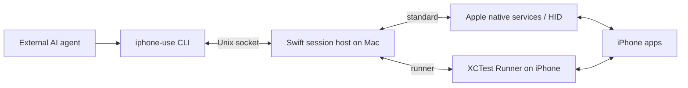

<h1>
  <picture>
    <source media="(prefers-color-scheme: dark)" srcset="assets/brand/iphone-use-wordmark-dark.svg">
    
  </picture>
</h1>

**Eyes and hands for AI agents operating a real iPhone.**

**English** · [简体中文](README.zh-CN.md)

[](https://github.com/HughLee824/iphone-use/actions/workflows/ci.yml)
[](LICENSE)
[](Package.swift)

iPhone-use is a macOS CLI that lets an external agent discover apps, read screenshots and accessibility data, and interact with a connected iPhone. Your agent handles natural language, planning, and judging results; iPhone-use provides device observations and actions through a persistent device session.

An agent needs local command execution and the ability to read PNG files. The device control path runs locally on your Mac and iPhone.

[Website](https://iphone-use.com) · [First iPhone task](docs/first-task.md) · [Client plugins](docs/plugins.md) · [Commands](#commands) · [Documentation](#documentation)

CLI and plugin channels update independently. These guides describe the current source; use [release notes](https://github.com/HughLee824/iphone-use/releases) and installed command help to check version-specific support.

## Control modes

This checkout supports **standard** (screenshot + native HID) and **runner** (XCTest). Choose with `iphone-use config set mode standard` or `runner`, then `iphone-use connect --device "$DEVICE"`; override one connection with `--mode standard|runner`. Preferences live in `~/.iphone-use/config.json`. Existing `--backend` and signed `--xctestrun` usage remain compatible. New users default to standard; valid legacy Runner setup migrates to runner. An active session never changes backend when preferences change.

Standard currently requires the documented macOS/Xcode/iOS 27 environment, pairing, Developer Mode and unlock, but no Runner signing. Both modes provide the main gestures, app lifecycle operations and shared native recording; element access and text/key behavior still differ. Consult the returned support/readiness fields. See [mode selection, migration and Agent rules](docs/control-modes.md). The walkthrough below starts with standard mode; Runner signing is optional.

## Why iPhone-use?

- **See the screen and its structure.** Both modes return screenshots; Runner also returns available AX elements. Expand or search its cached snapshots with `inspect`.
- **Act on real apps.** Discover installed apps, bring them to the foreground, tap, swipe, drag, edit text, and send editing keys.
- **Reuse the device session.** Independent CLI calls share one Mac host and the selected control connection. `connect` manages startup; `disconnect` or idle expiry releases the session.
- **Know what happened.** Actions distinguish `completed`, `not_dispatched`, and `unknown`. Tap and swipe check the screen before dispatch; input actions check frame stability afterward.
- **Use a small native stack.** Swift, native bridges and Apple's device tooling, with a thin XCTest Runner when that mode is selected. The runtime needs no Python, Node.js, WebDriverAgent, `iproxy`, or `pymobiledevice3`.

## Quick start

Install the published CLI through Homebrew or the Release archive, then start with standard mode. Runner signing is a separate optional path. See [first task](docs/first-task.md) and [installation](docs/install.md) for installation and upgrades. The current plugin and portable skill require stable **CLI 0.4.0 or later** and update separately; see [client compatibility](docs/plugins.md#先检查环境).

### 1. Prepare and connect

Standard mode currently targets macOS 27 / iOS 27, tested on Apple Silicon with Xcode 27 and iPhone 12 Pro. It requires full Xcode, device trust, Developer Mode and unlock, **without development signing or Runner setup**. The binary deployment minimum is not a device-compatibility promise.

For source development, run `swift build` and use `.build/debug/iphone-use`. For a local candidate package, retain the complete directory and add its `bin` to PATH; it runs outside the source checkout.

```sh
command -v iphone-use
iphone-use --version
xcrun --find devicectl
iphone-use devices
export IOS_UDID="DEVICE_ID_FROM_DEVICES"
iphone-use connect --device "$IOS_UDID" --mode standard
```

`--mode standard` selects this connection only. Fresh users also default to standard without it; saved preferences or valid legacy Runner preparation can retain runner mode. Use `iphone-use config set mode standard` to save an intentional default.

Before input, require `result.controlAvailable=true`; `ok:true` alone can describe an observation-only session. If unavailable, read `controlErrorCode`, `controlError` and `recovery`, disconnect this session and resolve the reported cause before reconnecting. See [first-use checks](docs/install.md) for full Xcode selection, device authorization and media ownership errors. Standard-mode errors do not require Runner setup.

### 2. Observe, act and verify

Open a harmless test page on the phone and retain the session returned by connect:

```sh
export SESSION="SESSION_FROM_CONNECT"
iphone-use --session "$SESSION" observe
```

Open the returned PNG with an image tool. Standard mode returns a screenshot observation ID such as `o1`, without element references. Select a visible button using **screen-point coordinates** from the observation. Map original PNG pixels into the reported `screen_points` rectangle; do not pass screenshot pixels or resized-preview coordinates directly. Replace every placeholder below:

```sh
iphone-use --session "$SESSION" tap OBSERVATION_ID --x POINT_X --y POINT_Y --observe
# Read the new PNG and confirm the intended page/counter changed.
iphone-use --session "$SESSION" disconnect
```

A command acknowledgment or screenshot path is not success verification. Use a fresh observation for the next action; observe an unknown result before deciding, never replay automatically. Development acceptance uses the ordinary Probe; controlling other installed apps does not require it.

### Optional: Runner mode

Developers wanting XCTest and available element references can choose Runner. With a complete package and existing Apple Development credentials plus a matching profile:

```sh
iphone-use setup --device "$IOS_UDID"
iphone-use connect --device "$IOS_UDID" --mode runner
```

`setup` does not change the default mode; use `iphone-use config set mode runner` for that. Source developers follow [signing setup](docs/onboarding.md#源码开发入口), run `build-runner`, then connect with its returned `.xctestrun`. Runner starts the installed app independently in the background and uses authenticated USB loopback communication; `connect` does not reinstall it or require WLAN access. Source-built apps must be explicitly installed before connecting. Runner observations allow `oN:eN` references where supported. Consult support fields and [action contracts](docs/actions.md) for mode-specific behavior.

External agent plugins are optional; see [plugin installation](docs/plugins.md). Source validation and physical acceptance are described in the [testing guide](docs/testing.md).

## Commands

Use `iphone-use --help` or `iphone-use <command> --help` for all options. Session commands use `iphone-use --session "$SESSION" <command>`.

| Command | Purpose |
| --- | --- |
| `devices` | List devices known to CoreDevice and their native connection state. |
| `setup --device ID` | Re-sign and verify a packaged Runner for a device. |
| `build-runner` | Build a signed Runner from source and return its `.xctestrun` path. |
| `connect --device ID` | Start a session; optionally set `--idle-timeout 60m`. |
| `status` | Check session health and remaining idle time without renewing it. |
| `apps [--query TEXT]` | Find installed apps by name or bundle ID; follow `nextOffset` for more results. |
| `open BUNDLE_ID` | Launch or activate an installed app. |
| `home oN [--observe]` | Press Home after checking the current screenshot; inspect the result. |
| `terminate BUNDLE_ID [--observe]` | Stop the specified app and confirm its stopped state. |
| `relaunch BUNDLE_ID [--observe]` | Confirm the app has stopped, launch it once, then inspect the screenshot for page readiness. |
| `observe` | Capture a PNG and compact AX text with new references. |
| `inspect REF [--query TEXT]` | Read or search a cached observation or subtree. |
| `tap REF` | Tap an element, or use an observation ID with `--x X --y Y`. |
| `swipe REF --direction up` | Swipe an element; explicit endpoints, velocity, and hold durations are also supported. |
| `focus REF --observe` / `type REF --text TEXT --observe` | Runner: explicit focus, then insertion; [replacement/append workflows](docs/runner-actions.md). Standard keeps its native modes. |
| `press REF --key KEY` | Send an editing key to an already focused text input; see [supported keys](docs/runner-editing-keys.md). |
| `disconnect` | Finish accepted commands and clean up the session. |

Both modes also support `type oN --mode insert --method touch-paste --text TEXT`: stage the clipboard without keyboard events, touch the visible Paste menu, verify, then `text-finish`. See [the workflow](docs/actions.md#纯剪贴板与触摸粘贴两种模式).

Coordinates use **screen points**, not screenshot pixels. Swipe direction describes finger movement. Text input does not submit automatically; use a separate `press` when appropriate. See [actions](docs/actions.md) for text limits, dragging, and examples.

## Local live preview

CLI 0.4.0 includes a read-only browser preview in both standard and runner modes, sharing the owned native video stream without Device Hub. Use `preview` from the installed release package; no source build is required. Device acceptance covers the documented Apple Silicon / macOS 27 / Xcode 27 / iPhone 12 Pro environment, not every device or OS combination. See the [release notes](https://github.com/HughLee824/iphone-use/releases/tag/v0.4.0) for the actual acceptance scope.

The viewer selects the device appearance by exact `productType`: retained official artwork for 23 iPhone 11–16 models, and independently drawn parameterized frames for covered newer models including 17 / Air and 18 Pro / Pro Max. Missing assets or unknown models use a drawn frame; the plain-view toggle has been removed. Portrait and both landscape directions remain supported. The model name and connection indicator sit below the device; the fullscreen button has been removed. Debug builds provide an appearance comparison button when official artwork is available; Release builds hide it. The page follows the system color scheme and keeps the video size and centre unchanged when switching appearances. All 32 supported identifiers have model-specific opening geometry calibrated against the corresponding retained PNG or public dimensional drawing; see the [calibration inventory](docs/preview-hardware-calibration.md). Restricted newer Apple artwork is not included. See [Product Bezels provenance and separate license](assets/preview/README.md).

```sh
iphone-use --session "$SESSION" preview            # Open the browser
iphone-use --session "$SESSION" preview --no-open  # Return only the local URL
iphone-use --session "$SESSION" record-start --duration 60
export RECORDING_ID="RECORDING_ID_FROM_RESULT"
# Save the returned recordingID; observe again before controlling the device.
iphone-use --session "$SESSION" record-stop "$RECORDING_ID"
iphone-use --session "$SESSION" preview --stop
```

`connect --progress` emits newline-delimited `connection_progress` JSON events followed by the final connection result. Agents should relay confirmed authorization requests immediately and continue the same pending connection. Enter passcodes only on the iPhone. Confirmation requires a live device log associated with the exact launched Runner PID; timeouts, stalled video and unavailable logging never establish authorization.

For Runner, `connect --device "$IOS_UDID" --mode runner --progress --preview` starts the preview page before authentication; `--port 9876` overrides the configured port. It returns a URL without opening a browser. The page shows conditional startup guidance, a prominent confirmed-authorization notice, and then live media on the same URL after authentication and connection complete. Omitting `--progress` preserves the single-JSON output contract. This dedicated screen is only for confirmed UI Automation authentication; Face ID and other app prompts remain visible in the live feed. See [connection progress and authorization](skills/iphone-use/references/connection-progress.md) and [validation procedures](docs/testing.md).

Preview defaults to port **8765**. Use `iphone-use config get preview-port` to inspect the default and `iphone-use config set preview-port 9876` to save a different port for the next start. A one-time `iphone-use --session "$SESSION" preview --port 9877 --no-open` takes precedence. If the port is occupied (`preview_port_in_use`), retry with another port in the same session. Stop an already running preview before changing its port.

The target ceiling is 30 fps with a 960-pixel longest edge; stable 30 fps has not passed acceptance, and resource pressure can cause stalls. Rotation ends the recording segment and may take time to display correctly. There is no audio or browser input control. Closing the tab does not stop preview, and browser requests do not renew the session. Avoid connecting/previewing the same phone in Device Hub concurrently. See [usage, implementation and limitations](docs/local-preview.md) and [testing procedures](docs/testing.md).

## Agent integration

Install the self-contained [iPhone-use plugin](plugins/iphone-use/README.md) from this repository's public Git marketplace:

```sh
# Codex (command names checked on CLI 0.146.0)
codex plugin marketplace add HughLee824/iphone-use
codex plugin add iphone-use@iphone-use

# Claude Code
claude plugin marketplace add HughLee824/iphone-use
claude plugin install iphone-use@iphone-use
```

Start a new client session and invoke `$iphone-use:iphone-use` in Codex or `/iphone-use:iphone-use` in Claude Code. Follow [the first-task guide](docs/first-task.md) for Xcode, signing, setup, verification, and upgrades. The plugin contains shared device rules, a read-only prerequisite check, [Codex call templates](skills/iphone-use/references/codex-calls.md), and [Claude Code Bash/Read instructions](skills/iphone-use/references/claude-code.md). It does not install the CLI or prepare signing. Distribution through this project's marketplace is separate from an official-directory listing.

DeepSeek Harness can use the `dsh-iphone-use` bundle in the same package, reusing this skill. In Add plugin, enter `dsh-iphone-use` or `https://github.com/HughLee824/iphone-use`; see [Harness installation and validation scope](docs/plugins.md#deepseek-harness-安装).

For Cursor and OpenCode, use the portable skill installer with conflict checks:

```sh
npx iphone-use-skill install --agent cursor
npx iphone-use-skill check --agent cursor
# OpenCode: replace cursor with opencode. Default scope is this project.
```

See [portable skill installation](docs/plugins.md#通用-skillcursor--opencode) for scope, updates, duplicate handling, and verification limits. Keep the existing plugin in Codex, Claude Code and DeepSeek Harness; do not add a second standalone copy. Manual copying or third-party skill installers do not run these conflict checks.

Add `--observe` to `open`, `tap`, `swipe`, `type`, or `press` to return one JSON object containing separate `action` and `observation` responses. Exit code zero requires both to succeed; an observation failure never overwrites the action's outcome or replays input. A confirmed rejection without a refresh requirement skips observation. This client-side sequence uses the existing host protocol, including older hosts; it does not reserve the device between requests. Read `observation.result.text` and its `screenshot` before choosing the next input. See [the contract and examples](docs/actions.md#动作后观察).

Check the installed command's `--help` for `--observe` support. If that capability is unavailable after version preflight, use the [action-and-observation fallback template](skills/iphone-use/references/action-observation.md).

Successful `observe` and `inspect` commands print multiline text. Other results and runtime errors use single-line JSON. Success exits with `0`; runtime failure exits with `1`. Argument syntax errors are reported on stderr with a nonzero exit code.

For `open`, `tap`, `swipe`, `type`, and `press`, read the action outcome as well as the exit code:

| Outcome | Meaning | Next step |
| --- | --- | --- |
| `completed` | Input calls completed and, for tap/swipe/type/press, the frame passed the stability check. `open` reports launch/activation completion. | Observe and verify the intended effect. |
| `not_dispatched` | The request was rejected before any input API call. | Read the error; correct the request or observe again. |
| `unknown` | Input may have taken effect, but completion could not be established. | Observe first. Do not blindly repeat the action. |

Runner input actions sample the screen about every 200 ms and use a comparison that tolerates localized caret blinking; results report the actual stability window and comparison facts. If stability is not reached within the 5-second detection budget, the result is `unknown` / `frame_stability_timeout`, with available input facts and the last frame. This budget is not a hard timeout for the entire command.

Keep these rules in the calling agent's workflow:

- **Refresh after actions.** Completed or unknown app/device actions invalidate old references. Detected target or context changes can invalidate them too. A result screenshot has no new AX references; call `observe` before the next reference-based action.
- **Search the snapshot you have.** `inspect --query` searches all captured nodes before pagination. It neither captures missing source data nor makes stale references current.
- **Read the image.** A path in stdout is not visual input. The agent must open the PNG with its own image-reading tool.
- **Track command completion.** If the execution tool returns a background job ID, use its continuation mechanism to collect the original command's exit code and output. That ID is separate from iPhone-use's device `session`.
- **Keep guard defaults.** Screen-change limits apply before input, relative to the observation. Expected scrolling or animation size is not a reason to raise them.
- **Close the session.** The default idle timeout is 30 minutes. `status` does not renew it, and accepted or running commands are not interrupted by idle expiry. Disconnecting or expiring removes the socket and observation cache.

Details: [observations](docs/observations.md), [actions](docs/actions.md), and [screen guard](docs/screen-guard.md).

## How it works



Standard observations and pre-input image checks use Apple CoreDevice PNG exclusively; media starts for explicit recording or preview requests, with geometry checks while in use. Screenshot failures never fall back to media pixels.

`connect` starts the host and fixes the selected mode. Standard connects to Apple native services and owns its HID connection and any explicitly requested recording/preview stream; Runner starts the already-installed XCTest app in the background and sends authenticated commands through USB loopback. Deployment belongs to explicit `setup`. The host retains the connection between CLI calls, serializes requests, caches observations and manages cleanup. It never switches control routes automatically.

Session files default to `/private/tmp/iphone-use-<uid>` with directory permissions `0700`; `IPHONE_USE_STATE_DIR` can select an alternative path. Packaged Runner preparation lives in `~/Library/Application Support/iphone-use`. Signing private keys stay in Keychain; the device token stays in host memory and the XCTest subprocess environment.

| Location | Responsibility |
| --- | --- |
| [`Sources/IPhoneUse`](Sources/IPhoneUse) | CLI commands and argument parsing. |
| [`Sources/IPhoneUseCore`](Sources/IPhoneUseCore) | Sessions, transport, observations, actions, signing, and device discovery. |
| [`packages/runner-support`](packages/runner-support) | Static macOS/iOS module for shared AX, input transactions and screen guards. |
| [`Runner`](Runner) | Thin iOS XCTest Runner and standalone Xcode project. |
| [`Tests`](Tests) | Swift tests and sanitized fixtures for host behavior and device contracts. |
| [`scripts`](scripts) / [`packaging`](packaging) | Release packaging, verification, and Homebrew tooling. |
| [`docs`](docs) | Public usage guides, architecture, and curated examples. |

## Current limitations

iPhone-use is in early development. Real-device validation covers the environment listed above, not every Mac, Xcode, iOS version, or app.

- The Swift package targets macOS 13+, and the packaged Runner has an iOS 17 compilation floor. These are build limits, not claims of end-to-end support. Binary distribution targets Apple Silicon / macOS 15+.
- Full Xcode is required in both modes; local development signing is required only for Runner. Fresh-Mac onboarding and free Personal Team provisioning/renewal remain unverified. The Mac CLI is ad-hoc signed; Developer ID signing and notarization are not in the current release workflow.
- Screenshot and AX capture are separate, non-atomic operations. Default observation text is capped at 60 lines / 8 KiB. Runner exports the full tree returned by XCTest; `inspect` searches/paginates the cached nodes independently of that display budget. Transport size/time limits still apply and fail explicitly rather than silently truncating the tree.
- Screen guards are heuristic checks, not an atomic guarantee against an app changing before input. XCTest runtime compatibility is limited to tested configurations.
- Automatic recovery after a killed host, Mac restart, cable disconnect, or device lock is not guaranteed. Unknown actions are not automatically replayed.

## Documentation

[Documentation index](docs/README.md) includes public guides, command contracts and maintenance procedures.

The complete first-task and architecture guides are in English; detailed command and signing guides are in Chinese. Both README versions cover the same getting-started workflow.

| Guide | Contents |
| --- | --- |
| [First iPhone task](docs/first-task.md) · [Client plugins](docs/plugins.md) | Public install paths for Codex and Claude Code, device setup, verification, and upgrades. |
| [Installation](docs/install.md) | Release packages, Homebrew, upgrades, and uninstalling. |
| [Onboarding and troubleshooting](docs/onboarding.md) | Xcode, signing, first connection, renewal, and common errors. |
| [Device and app discovery](docs/discovery.md) | Discovery commands, pagination, and CoreDevice diagnostics. |
| [Observations](docs/observations.md) · [Sample output](docs/examples/observe/README.md) | Screenshots, AX text, cached queries, references, and examples. |
| [Actions](docs/actions.md) · [Screen guard](docs/screen-guard.md) | Input semantics, controlled dragging, stability, and pre-dispatch checks. |
| [Local browser preview](docs/local-preview.md) · [Testing](docs/testing.md) | Source preview in both modes, recording coexistence, performance and rotation limits. |
| [Architecture and repository layout](docs/architecture.md) | Component responsibilities, session lifecycle, and tracked versus local files. |
| [Release workflow](docs/release-setup.md) | Building, verifying, and distributing the CLI and Runner. |

## Contributing

[Contribution and Git/PR conventions](CONTRIBUTING.md) · [Security reports](SECURITY.md)

Issues, focused pull requests, and reproducible device reports are welcome. For a substantial change, open an [issue](https://github.com/HughLee824/iphone-use/issues) to discuss the scope first.

Run the same checks configured in [CI](.github/workflows/ci.yml):

```sh
python3 scripts/tools/install-swiftlint.py
python3 scripts/tools/install-actionlint.py
python3 scripts/check.py
```

Python 3.9+ is used for release tooling and development tests, not the installed CLI runtime. The check entry point requires full Xcode and the pinned SwiftLint and Actionlint versions, builds the CLI before integration tests, and supplies its executable path explicitly. A missing CLI fails the check. Build concurrency defaults to two jobs. The only external Swift package dependency is [Swift ArgumentParser](https://github.com/apple/swift-argument-parser/tree/1.5.0), pinned to `1.5.0`.

Node.js 22+ runs the documented call templates against controlled tool responses in CI; it is only needed for development tests. After changing the canonical skill, run `python3 scripts/plugin/sync-plugin.py` to update its packaged copy and use `python3 scripts/plugin/set-plugin-version.py X.Y.Z` to update all shared distribution versions before release. CI also compiles the Runner without signing and packages the plugin for review. Website source, tests and Cloudflare deployment are maintained separately in [iphone-use-website](https://github.com/HughLee824/iphone-use-website). See [public-access release checks](docs/public-access-release.md) for the exact commands and hardware acceptance requirements.

CI does not have a physical iPhone. For device-facing changes, also build a fresh Runner and verify the affected workflow on hardware. Include Mac/Xcode/iOS versions, reproduction steps, expected behavior, and relevant errors in reports. Remove private screen content, provisioning profiles, and signing material before sharing logs. Keep the English and Chinese READMEs in sync when changing shared instructions. Follow the [repository layout](docs/architecture.md#repository-layout) when adding files; local experiments and device records stay outside Git.

## License

[MIT](LICENSE) © iPhone-use contributors.
