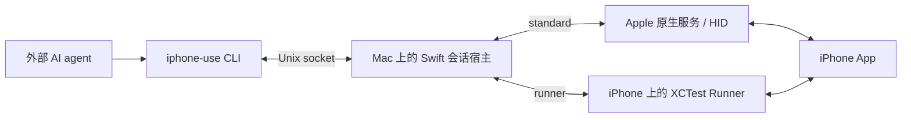

<h1>
  <picture>
    <source media="(prefers-color-scheme: dark)" srcset="assets/brand/iphone-use-wordmark-dark.svg">
    
  </picture>
</h1>

**为操作真实 iPhone 的 AI agent 提供眼睛和手。**

[English](README.md) · **简体中文**

[](https://github.com/HughLee824/iphone-use/actions/workflows/ci.yml)
[](LICENSE)
[](Package.swift)

iPhone-use 是一个 macOS CLI，让外部 agent 能够发现 App、读取截图与辅助功能数据，并操作连接的 iPhone。自然语言理解、任务规划和结果判断由调用 agent 负责；iPhone-use 通过所选模式的持续会话提供设备观察与动作能力。

调用 agent 需要具备本机命令执行和 PNG 读图能力。设备控制链路在你的 Mac 和 iPhone 上本地运行。

[网站](https://iphone-use.com) · [首个 iPhone 任务](docs/first-task.md) · [客户端插件](docs/plugins.md) · [命令概览](#命令概览) · [文档导航](#文档导航)

CLI 与插件独立更新。文档描述当前源码；具体版本支持范围以[发布说明](https://github.com/HughLee824/iphone-use/releases)和已安装命令的帮助为准。

## 控制模式

当前源码提供 **standard**（截图 + 原生 HID）和 **runner**（XCTest）两种模式。用 `iphone-use config set mode standard` 或 `runner` 设置默认，再运行 `iphone-use connect --device "$DEVICE"`；单次覆盖使用 `--mode standard|runner`。偏好保存在 `~/.iphone-use/config.json`，原有 `--backend` 和签名 `--xctestrun` 用法保持兼容。新用户默认 standard，有效的旧 Runner 配置迁移为 runner；修改偏好不会改变已有会话。

标准模式目前仍要求已记录的 macOS/Xcode/iOS 27 环境、配对、Developer Mode 和解锁，但不需要 Runner 签名。两种模式已提供主要手势、应用生命周期和共享原生录屏；元素访问、文字与按键行为仍有差异，以会话返回的支持能力和就绪状态为准。详见[模式配置、迁移与 Agent 规则](docs/control-modes.md)。下方以标准模式入门，Runner 签名为可选步骤。

两种模式还可显式使用 `type oN --mode insert --method touch-paste --text TEXT`：只准备剪贴板，再触摸可见的粘贴菜单，核验后用 `text-finish` 恢复剪贴板；不发送键盘事件。详见[操作流程](docs/actions.md#纯剪贴板与触摸粘贴两种模式)。

## 为什么选择 iPhone-use？

- **同时观察画面与界面结构。** 两种模式都返回截图；Runner 额外提供可用 AX 元素，可用 `inspect` 展开或搜索缓存快照。
- **操作真实 App。** 发现已安装 App、切换前台、点击、滑动、拖动、编辑文本，以及发送 Return。
- **跨命令复用设备会话。** 独立 CLI 调用共享同一个 Mac 宿主及所选控制连接。`connect` 管理启动，`disconnect` 或空闲到期释放会话。
- **明确动作执行状态。** 区分 `completed`、`not_dispatched` 和 `unknown`。点击与滑动在派发前校验画面，输入动作在执行后检测帧稳定。
- **精简的原生技术栈。** 使用 Swift、自写原生桥接及 Apple 设备工具；选择 Runner 模式时运行薄 XCTest Runner。运行时无需 Python、Node.js、WebDriverAgent、`iproxy` 或 `pymobiledevice3`。

## 快速开始

通过 Homebrew 或 Release 归档安装正式 CLI，然后从标准模式开始；Runner 签名是独立的可选流程。完整安装与升级步骤见[首次任务](docs/first-task.md)和[安装说明](docs/install.md)。当前插件与通用 skill 要求稳定版 **CLI 0.4.0 或更高版本**，需单独更新；详见[客户端兼容说明](docs/plugins.md#先检查环境)。

### 1. 准备并连接

当前标准模式适配 macOS 27 / iOS 27，已测 Apple Silicon、Xcode 27、iPhone 12 Pro。需要完整 Xcode、设备信任、Developer Mode 和解锁，**不需要开发签名或 Runner setup**。包的最低编译版本不代表完整链路兼容范围。

源码开发运行 `swift build` 后使用 `.build/debug/iphone-use`；本地候选包保留完整目录，将 `bin` 加入 PATH，可在源码目录外使用。

```sh
command -v iphone-use
iphone-use --version
xcrun --find devicectl
iphone-use devices
export IOS_UDID="DEVICE_ID_FROM_DEVICES"
iphone-use connect --device "$IOS_UDID" --mode standard
```

`--mode standard` 只选择这次连接。新用户省略它时也默认 standard；已有偏好或有效旧 Runner 准备状态可能保留 runner。使用 `iphone-use config set mode standard` 保存默认值，后续可省略 `--mode`。

发送输入前必须确认 `result.controlAvailable=true`；只有 `ok:true` 可能只是观察会话。不可控时读取 `controlErrorCode`、`controlError` 和 `recovery`，关闭本次会话，解决原因后再显式连接。完整 Xcode 选择、设备授权和媒体占用的处理见[首次检查](docs/install.md)。标准模式的这些问题不需要 Runner setup。

### 2. 观察、操作、验证

在手机上打开一个适合测试的无害页面，保存 connect 返回的会话：

```sh
export SESSION="SESSION_FROM_CONNECT"
iphone-use --session "$SESSION" observe
```

用读图工具打开返回的 PNG。标准模式只有截图观察 ID，例如 `o1`，没有元素引用。根据当前图片选择可见按钮，命令接收**屏幕点坐标**：将原 PNG 中的选点按本次观察的 `screen_points` 矩形换算。例如 `x = screen.x + pixelX × screen.width / imageWidth`，y 同理；不能直接传截图像素或缩放预览坐标，也不能固定除以 3。下方占位符必须替换：

```sh
iphone-use --session "$SESSION" tap OBSERVATION_ID --x POINT_X --y POINT_Y --observe
# 读取新截图，确认预期页面或计数变化。
iphone-use --session "$SESSION" disconnect
```

动作回执和截图路径不是成功证明。下一次动作使用新观察；结果 unknown 时先观察，禁止自动重放。开发验收使用普通 Probe，控制其他已安装 App 不要求安装 Probe。

### 可选：使用 Runner

需要 XCTest 与可用元素引用的开发者可以选择 Runner。完整发布包使用已有 Apple Development 证书和匹配 profile 重签：

```sh
iphone-use setup --device "$IOS_UDID"
iphone-use connect --device "$IOS_UDID" --mode runner
```

`setup` 不改默认模式；需要持久使用 Runner 时运行 `iphone-use config set mode runner`。源码开发者按[签名入口](docs/onboarding.md#源码开发入口)运行 `build-runner`，显式安装返回的已签名 Runner App 后，再使用返回的 `.xctestrun` 连接。普通 connect 不会自动安装。Runner 观察可在支持的动作中使用 `oN:eN`；两种模式的操作及文字语义以支持字段和[动作契约](docs/actions.md)为准。

外部 Agent 插件为可选，安装方法见[插件指南](docs/plugins.md)。源码检查与真机验收范围见[测试指南](docs/testing.md)。

## 命令概览

使用 `iphone-use --help` 或 `iphone-use <command> --help` 查看全部参数。会话命令采用 `iphone-use --session "$SESSION" <command>`。

| 命令 | 用途 |
| --- | --- |
| `devices` | 列出 CoreDevice 已知设备及其原生连接状态。 |
| `setup --device ID` | 为设备重签并验证发布包内的 Runner。 |
| `build-runner` | 从源码构建已签名 Runner，返回 `.xctestrun` 路径。 |
| `connect --device ID` | 启动会话，可用 `--idle-timeout 60m` 调整空闲时限。 |
| `status` | 检查会话健康状态和剩余空闲时间，不续期。 |
| `apps [--query TEXT]` | 按名称或 bundle ID 查找已安装 App，使用 `nextOffset` 继续分页。 |
| `open BUNDLE_ID` | 启动或激活已安装 App。 |
| `observe` | 采集 PNG 和紧凑 AX 文本，生成新引用。 |
| `inspect REF [--query TEXT]` | 读取或搜索缓存观察及其子树。 |
| `tap REF` | 点击元素；也可传观察 ID 并指定 `--x X --y Y`。 |
| `swipe REF --direction up` | 滑动元素，也支持明确端点、速度和按住时长。 |
| `focus REF --observe` / `type REF --text TEXT --observe` | Runner：显式聚焦后插入文字；[替换与追加流程](docs/runner-actions.md)由 agent 编排。standard 保持原生输入模式。 |
| `press REF --key return` | 向已有焦点的输入框发送 Return。 |
| `disconnect` | 等待已接收命令完成并清理会话。 |

坐标单位为**屏幕点**，不是截图像素。滑动方向表示手指移动方向。文本输入不会自动提交，需要时单独调用 `press`。文本限制、拖动参数与示例见[动作接口](docs/actions.md)。

## 本地实时预览（源码实验功能）

当前源码的 standard 和 runner 均支持共享原生视频流的只读浏览器预览，无需 Device Hub。请使用包含 `preview` 命令的源码构建，不代表已发布 CLI 包已经包含此能力。

预览按 `productType` 精确匹配外观：保留 iPhone 11–16 系列 23 个机型的官方素材；已覆盖的 17 / Air、18 Pro / Pro Max 等机型使用独立绘制的参数化外框。缺失素材和未知机型使用自绘外框，已删除纯画面切换；保留横竖屏，已删除全屏按钮。Debug 构建在有官方素材时提供外观对比按钮，Release 构建隐藏该按钮；页面跟随系统明暗模式，切换外观时保持视频尺寸与中心不变。已支持的 32 个精确标识均有自绘开孔参数，按对应官方 PNG 或公开尺寸图校准，详见[逐机型校准清单](docs/preview-hardware-calibration.md)。新版受限 Apple 素材不随包分发。素材来源与独立许可见 [Product Bezels](assets/preview/README.md)。

```sh
iphone-use --session "$SESSION" preview            # 打开浏览器
iphone-use --session "$SESSION" preview --no-open  # 只返回本地 URL
iphone-use --session "$SESSION" record-start --duration 60
export RECORDING_ID="RECORDING_ID_FROM_RESULT"
# 保存返回的 recordingID；重新 observe 后再执行控制。
iphone-use --session "$SESSION" record-stop "$RECORDING_ID"
iphone-use --session "$SESSION" preview --stop
```

`connect --progress`：连接过程中逐行输出 `connection_progress` JSON，最后仍返回连接结果。Agent 应立即转达明确的授权提示，继续等待同一次连接；密码只在手机上输入。只有与本次 Runner PID 匹配的设备日志才会确认“需要授权”，普通超时、断流或日志不可用不会被当作授权请求。

Runner 可用 `connect --device "$IOS_UDID" --mode runner --progress --preview` 在认证前启动预览页，`--port 9876` 可覆盖端口；工具返回 URL，不自动打开浏览器。页面先显示等待指引，确认授权请求后显示醒目提示，完成认证并连接后在同一网址显示实时画面。默认不加 `--progress` 的单份 JSON 输出保持兼容。专属引导只用于明确的 UI Automation 认证；Face ID 等 App 弹窗保留在真实画面中。详情见 [连接进度与授权](skills/iphone-use/references/connection-progress.md) 和 [测试流程](docs/testing.md)。

预览默认使用固定端口 **8765**。用 `iphone-use config get preview-port` 查看默认值，`iphone-use config set preview-port 9876` 保存下次启动使用的端口。单次指定 `iphone-use --session "$SESSION" preview --port 9877 --no-open` 优先级最高。端口占用会返回 `preview_port_in_use`，可在同一会话换端口重试；已运行的预览需先停止才能更换端口。

目标上限为 30 fps、最长边 960 像素；稳定 30 fps 尚未通过验收，资源紧张时可能卡顿。旋转会结束录屏片段，方向恢复可能延迟；无音频和网页触控。关闭标签页不等于停止预览，浏览器请求也不续期会话。避免与 Device Hub 同时连接/预览同一手机。完整使用步骤、实现与限制见[本地浏览器预览](docs/local-preview.md)，验证方法见[测试指南](docs/testing.md)。

## Agent 接入约定

推荐从项目自有公开 Git marketplace 安装自包含 [iPhone-use 插件](plugins/iphone-use/README.md)：

```sh
# Codex：命令名已核对 CLI 0.146.0
codex plugin marketplace add HughLee824/iphone-use
codex plugin add iphone-use@iphone-use

# Claude Code
claude plugin marketplace add HughLee824/iphone-use
claude plugin install iphone-use@iphone-use
```

在新会话中分别调用 Codex 的 `$iphone-use:iphone-use` 或 Claude Code 的 `/iphone-use:iphone-use`。插件共用设备规则，包含只读前置检查、[Codex 模板](skills/iphone-use/references/codex-calls.md)及 [Claude Code Bash/Read 指引](skills/iphone-use/references/claude-code.md)。它不安装 CLI 或准备签名。Xcode、setup、首个任务和升级步骤见[插件指南](docs/plugins.md)与[完整首次任务路径](docs/first-task.md)。自有 marketplace 分发不代表已进入官方目录。

DeepSeek Harness 可通过同目录中的 `dsh-iphone-use` bundle 接入，复用上述 skill。在 Add plugin 中填写 `dsh-iphone-use` 或 `https://github.com/HughLee824/iphone-use` 即可选择安装来源，验证范围见[DeepSeek Harness 安装](docs/plugins.md#deepseek-harness-安装)。

仍支持手动将完整 `skills/iphone-use` 复制到客户端 skill 目录（Codex 为 `$CODEX_HOME/skills`，未设置时为 `~/.codex/skills`），在新任务中调用 `$iphone-use`。同时安装了两种形式时，用插件的命名空间调用避免混淆。明确选择源码流程时，前置检查支持 `--source`，连接使用已提供的签名 `.xctestrun`。

在 `open/tap/swipe/type/press` 后添加 `--observe`，即可返回包含独立 `action` 与 `observation` 回执的单个 JSON。两者均成功才退出 0；观察失败不会覆盖动作结果或重放输入。明确未派发且无需刷新时跳过观察。客户端顺序调用既有协议，兼容旧宿主，但不在两次请求之间独占设备。读取 `observation.result.text` 和其中的 `screenshot` 后再选择下一动作。详见[契约与示例](docs/actions.md#动作后观察)。

先通过已安装命令的 `--help` 确认是否支持 `--observe`；版本预检通过后，若该能力不可用，可使用 skill 中保留的[动作与观察回退模板](skills/iphone-use/references/action-observation.md)。

`observe` 和 `inspect` 成功时输出多行文本；其他结果及运行时错误为单行 JSON。成功退出码为 `0`，运行失败为 `1`。参数语法错误输出到 stderr，并以非零状态退出。

调用 `open`、`tap`、`swipe`、`type` 和 `press` 时，除退出码外还要检查动作结果：

| 结果 | 含义 | 下一步 |
| --- | --- | --- |
| `completed` | 输入调用完成；tap/swipe/type/press 还通过了帧稳定检测。`open` 表示启动或激活完成。 | 再次观察，核对预期效果。 |
| `not_dispatched` | 在调用任何输入 API 前已拒绝请求。 | 阅读错误，修正请求或重新观察。 |
| `unknown` | 输入可能已生效，但无法确认完成状态。 | 先观察，不要盲目重复动作。 |

Runner 输入动作约每 200 ms 采样一次画面，通过允许小范围光标闪烁的帧比较判稳；具体窗口和判定事实随结果返回。5 秒检测预算内未稳定时，返回 `unknown` / `frame_stability_timeout`，并保留可获得的输入事实和最后一帧。该预算不是整条命令的硬超时。

调用 agent 应遵循以下约定：

- **动作后更新观察。** App 或设备动作完成、结果为 unknown 后，旧引用失效；检测到目标或上下文变化时也可能失效。动作结果截图不包含新 AX 引用，下一次按引用操作前需要 `observe`。
- **搜索已有快照。** `inspect --query` 先搜索全部已采集节点，再分页输出。它不会补采缺失数据，也不会恢复旧引用的有效性。
- **实际读取图片。** stdout 中的路径不会自动成为视觉输入，agent 必须通过自己的读图工具打开 PNG。
- **跟踪命令完成状态。** 如果命令工具返回后台任务 ID，须使用该工具的续读机制获取原命令的退出码和输出。这个 ID 与 iPhone-use 的设备 `session` 不同。
- **保留守卫默认值。** 画面变化阈值比较输入前画面与观察时画面，预计的滚动或动画幅度不是放宽理由。
- **结束后释放会话。** 默认空闲时限为 30 分钟，`status` 不续期，已接收或执行中的命令不会被空闲回收打断。断开或到期后删除 socket 和观察缓存。

详细行为见[观察契约](docs/observations.md)、[动作契约](docs/actions.md)和[动作前画面校验](docs/screen-guard.md)。

## 工作原理



标准模式的观察和动作前图片校验统一使用 Apple CoreDevice PNG；自有媒体在显式录屏或预览请求时启动，并保留媒体使用期间的几何校验。截图失败不会回退到媒体像素。

`connect` 启动宿主并固定所选模式。标准模式连接 Apple 原生服务、持有 HID 连接及显式请求的自有录屏/预览流；Runner 模式通过 Xcode 的 `test-without-building` 安装并启动 Runner。宿主跨 CLI 调用保持连接、串行请求、缓存观察并管理清理，不自动切换控制路线。

会话文件默认位于 `/private/tmp/iphone-use-<uid>`，目录权限为 `0700`，可通过 `IPHONE_USE_STATE_DIR` 更换路径。发布包 Runner 的准备状态位于 `~/Library/Application Support/iphone-use`。签名私钥留在 Keychain，设备 token 仅保存在宿主内存和 XCTest 子进程环境中。

| 目录 | 职责 |
| --- | --- |
| [`Sources/IPhoneUse`](Sources/IPhoneUse) | CLI 命令与参数解析。 |
| [`Sources/IPhoneUseCore`](Sources/IPhoneUseCore) | 会话、通信、观察、动作、签名和设备发现。 |
| [`packages/runner-support`](packages/runner-support) | 宿主与 Runner 共用的 macOS/iOS 静态模块：AX、输入事务和画面校验。 |
| [`Runner`](Runner) | 薄 iOS XCTest Runner 与独立 Xcode 工程。 |
| [`Tests`](Tests) | 宿主行为与设备契约的 Swift 测试，以及脱敏测试数据。 |
| [`scripts`](scripts) / [`packaging`](packaging) | 发布打包、校验与 Homebrew 工具。 |
| [`docs`](docs) | 公开使用指南、架构说明和精选示例。 |

## 当前限制

iPhone-use 处于早期开发阶段。真机验收覆盖上述实测环境，不代表所有 Mac、Xcode、iOS 版本或 App 均受支持。

- Swift 包目标为 macOS 13+，发布 Runner 的 iOS 编译下限为 17。这些是构建下限，不是完整链路的支持承诺。二进制分发面向 Apple Silicon / macOS 15+。
- 两种模式都需要完整 Xcode；本机开发签名仅用于 Runner。全新 Mac 接入及免费 Personal Team 的首次 provisioning、续签尚未验收。Mac CLI 使用 ad-hoc 签名，当前发布流程未包含 Developer ID 签名和公证。
- 截图与 AX 分开采集，不构成原子快照。默认观察文本最多 60 行 / 8 KiB，源采集最多 200 个节点；`inspect` 不能恢复未采集节点。
- 画面守卫属于启发式校验，不能原子地阻止 App 在输入前自行变化。XCTest 运行时兼容性以已测试配置为限。
- 不保证宿主被强制终止、Mac 重启、拔线或设备锁屏后的自动恢复。结果未知的动作不会自动重放。

## 文档导航

[文档首页](docs/README.md)按使用指南、行为契约和维护流程组织全部公开文档。

完整首次任务和架构指南以英文提供；详细命令和签名指南以中文提供。中英文 README 覆盖相同的入门流程。

| 文档 | 内容 |
| --- | --- |
| [首个 iPhone 任务](docs/first-task.md) · [客户端插件](docs/plugins.md) | Codex / Claude Code 公开安装、设备准备、任务验证及升级。 |
| [安装说明](docs/install.md) | 发布包、Homebrew、升级与卸载。 |
| [首次接入与故障排查](docs/onboarding.md) | Xcode、签名、首次连接、续签和常见错误。 |
| [设备与 App 发现](docs/discovery.md) | 发现命令、分页与 CoreDevice 诊断。 |
| [观察契约](docs/observations.md) · [输出样例](docs/examples/observe/README.md) | 截图、AX 文本、缓存查询、引用及示例。 |
| [动作接口](docs/actions.md) · [画面校验](docs/screen-guard.md) | 输入语义、可控拖动、稳定检测与派发前检查。 |
| [本地浏览器预览](docs/local-preview.md) · [测试指南](docs/testing.md) | 两种模式的源码预览、录屏共存、性能与旋转限制。 |
| [架构与仓库布局](docs/architecture.md) | 模块职责、会话生命周期，以及公共文件与本地文件的边界。 |
| [发布流程](docs/release-setup.md) | CLI 与 Runner 的构建、校验及分发。 |

## 参与贡献

[贡献与 Git/PR 规范](CONTRIBUTING.md) · [安全问题报告](SECURITY.md)

欢迎提交 issue、聚焦的 pull request 和可复现的设备问题报告。较大改动建议先通过 [issue](https://github.com/HughLee824/iphone-use/issues) 讨论范围。

提交前运行与 [CI](.github/workflows/ci.yml) 一致的检查：

```sh
python3 scripts/tools/install-swiftlint.py
python3 scripts/tools/install-actionlint.py
python3 scripts/check.py
```

Python 3.9+ 仅用于发布工具和开发测试，不是已安装 CLI 的运行依赖。检查入口需要完整 Xcode，以及固定版本的 SwiftLint 和 Actionlint，先构建 CLI，再把可执行文件路径显式传给集成测试；缺少 CLI 会报错。默认构建并发为两个任务。唯一外部 Swift 包依赖为 [Swift ArgumentParser](https://github.com/apple/swift-argument-parser/tree/1.5.0)，锁定版本 `1.5.0`。

CI 使用 Node.js 22+ 将文档中的调用模板用于受控工具响应；Node 仅为开发测试所需。修改 canonical skill 后运行 `python3 scripts/plugin/sync-plugin.py` 更新包内副本；发布变更前使用 `python3 scripts/plugin/set-plugin-version.py X.Y.Z` 同步更新所有共享分发版本。CI 还会无签名编译 Runner，并打包插件供审阅。官网源码、测试和 Cloudflare 部署独立维护于 [iphone-use-website](https://github.com/HughLee824/iphone-use-website)。具体命令和真机验收要求见[公开接入发布检查](docs/public-access-release.md)。

CI 没有真实 iPhone。涉及设备行为的改动还需重新构建 Runner，并在真机验证受影响流程。问题报告应包含 Mac/Xcode/iOS 版本、复现步骤、预期行为和相关错误。分享日志前移除私人画面内容、provisioning profile 和签名资料。修改公共使用说明时，请同步更新中英文 README。新增文件请遵循[目录约定](docs/architecture.md#repository-layout)，本地实验和设备记录不进入 Git。

## 许可证

[MIT](LICENSE) © iPhone-use contributors。

### 通用 skill（Cursor / OpenCode）

```sh
npx iphone-use-skill install --agent cursor
npx iphone-use-skill check --agent cursor
```

OpenCode 将 `cursor` 换成 `opencode`。默认安装到当前项目的客户端专用目录，重复安装及升级前会检查冲突。Codex、Claude Code 和 DeepSeek Harness 继续使用现有插件。详见[安装范围、更新与冲突处理](docs/plugins.md#通用-skillcursor--opencode)。
