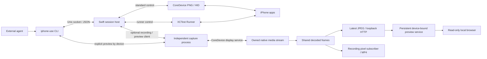

# Architecture and repository layout

iPhone-use provides observations and actions for an external agent operating a physical iPhone. The calling agent owns task planning, image interpretation, and judging outcomes. iPhone-use owns device access, reference validity, execution facts, and session cleanup.

The current source supports explicit [standard and runner modes](control-modes.md). Standard uses the [Apple native backend](apple-native-backend.md) for CoreDevice screenshots and HID; runner uses XCTest. Read-only preview and recording run in a separate per-device capture process, independently of both control backends. An active session never switches its control backend automatically.

## Runtime components



The CLI and host are two process roles of the same executable. A connection starts a host for that session and the selected control backend; runner mode launches the already-installed XCTest app with CoreDevice `--no-activate` and connects to its loopback listener through usbmuxd (USB only). Subsequent CLI calls reuse the host and its control connection. The diagram shows the shared recording path when preview is already active; recording without preview retains its independent decoder.

| Component | Owns |
| --- | --- |
| [CLI](../Sources/IPhoneUse/IPhoneUse.swift) | Argument parsing, command dispatch, text/JSON output, and exit codes. |
| [Session client](../Sources/IPhoneUseCore/Session/Client/SessionClient.swift) | Host startup, local IPC, response matching, and transport uncertainty. |
| [Session host](../Sources/IPhoneUseCore/Session/Host/SessionHost.swift) | Serial request execution, device ownership, observation references, outcome classification, and lifecycle coordination. |
| [Observation cache](../Sources/IPhoneUseCore/Observation/Observation.swift) | AX compaction, cached snapshots, queries, pagination, and reference invalidation. |
| [XCTest backend](../Sources/IPhoneUseCore/Backends/XCTest/XCTestBackend.swift) | Standalone Runner process ownership, capability checks, USB loopback transport, and backend cleanup. |
| [Device discovery](../Sources/IPhoneUseCore/Device/DeviceDiscovery.swift) | Device metadata, installed-app queries, and native-tool diagnostics. |
| [Runner setup](../Sources/IPhoneUseCore/Setup/RunnerSetup.swift) / [source build](../Sources/IPhoneUseCore/Setup/RunnerBuild.swift) | Preparing a packaged Runner with local signing, or building a signed Runner from source. |
| [iOS Runner](../Runner/LiveSessionTests.swift) | Screenshots, AX collection, app activation, input primitives, device-side checks, and execution facts. |

The Runner does not own agent-facing observation IDs, short references, snapshot caches, or task strategy. It receives resolved targets or coordinates from the host. Element actions use fresh AX identity binding; coordinate gestures use screen-context and local fingerprint checks. The host interprets returned execution facts as `completed`, `not_dispatched`, or `unknown`.

The host and native Xcode project depend on the local static Swift package [IPhoneUseRunnerSupport](../packages/runner-support/Package.swift). It contains shared AX identity/path algorithms, explicit input primitives, geometry, image comparison and bounded validation. It imports neither XCTest nor `IPhoneUseCore`/`AppleNativeBridge`; actual XCTest element access and Objective-C adapters remain in `Runner/`. The Runner links the package product instead of compiling individual Core source paths. Static linkage adds no embedded framework or runtime resource bundle. The production build does not depend on local experiments, an installed test Fixture app, or XcodeGen.

## Session lifecycle

1. `connect` resolves the device, acquires its lock within the state directory, starts the backend, and returns a session ID after readiness checks.
2. Independent CLI processes send requests through the session's Unix socket. Device requests run serially; the host retains observations between calls.
3. Starting a new observation invalidates previous references. The cache keeps the latest two successful observations; `inspect` can read a retained snapshot without making its references current again.
4. Before a device action, the host resolves the reference and marks existing references pending. Completion, an unknown outcome, or a detected target change invalidates them. A confirmed pre-dispatch rejection can preserve them when no other invalidation occurred.
5. `disconnect` stops admission, finishes accepted work, and releases the session's resources. Idle expiry follows the same cleanup path. Socket and observation files are removed; diagnostic files may remain.

The idle timeout defaults to 30 minutes and accepts `s`, `m`, or `h` units through `connect --idle-timeout`. Successful `apps`, `observe`, and `inspect` renew it when they finish. Valid `open` and locally resolved action requests also renew it, including unknown outcomes. Argument/reference failures do not renew it. `status` checks health without renewing the timeout. Accepted, queued, or running requests are protected from idle cleanup.

The host does not automatically replay unknown actions or restore old references after restarting. See [observations](observations.md), [actions](actions.md), and [screen guards](screen-guard.md) for detailed contracts.

The CLI's optional action `--observe` composes two existing host requests and returns their responses separately. It needs no new host or Runner protocol and does not reserve the serial queue between requests. Observation failure cannot overwrite action facts, and neither operation is replayed. See the [combined response contract](actions.md#动作后观察).

## Display identity

CoreDevice's single active display is authoritative on multi-display devices; `primary` can name an inactive outer screen. Ambiguous or incomplete activity fails closed. Older single-screen inventories without activity flags may include dormant wireless displays created by media capture: only one explicitly integrated primary display plus explicitly non-primary wireless displays with backlight off is accepted. Screenshot capture binds the display's unique identifier, while Runner screenshots and coordinate windows match its numeric display ID. Runner normalizes screenshot orientation before image comparison and uses the selected display's screen-point bounds. A display change invalidates prior input targets.

CLI and Runner require matching `displaySelectionVersion=1` support. Startup and explicit Home navigation activate SpringBoard through XCTest; bootstrap still requires XCTest's real background notification. Neither an acknowledged button event nor a successful navigation call proves the destination screen.

## Shared native preview and recording

An explicit `preview --device UDID` starts a per-device capture process and a read-only loopback viewer. It does not create or require a control session, HID, Runner, UI Automation authorization or an unlocked-screen preflight. Capture uses CoreDevice topology and decoded frame orientation, never XCTest observations. A private per-device process lock fences media ownership separately from the control lock. Existing session preview commands delegate to the same capture process. Viewer startup failure is reported separately from control startup.

The viewer service persists device-scoped random capabilities under the private configuration directory; it accepts authenticated source registration over a private Unix socket and never persists source URLs or frames. Source leases and browser decode-generation checks isolate reconnections. The capture process owns its own cancellation and topology timer. Control disconnect/idle expiry cannot close preview; explicit preview stop does not close control. Recordings reuse the capture process and are associated with the requesting client's owner ID; disconnect ends only that owner's recording. Capturing preview never renews the control idle deadline. After all media consumers stop, the capture process exits following ten idle minutes. HTTP remains read-only; geometric gesture receipts are optional asynchronous decoration and cannot delay/fail input.

Standard control obtains its own fresh Apple screenshots, checks lock/backlight, before/after display identity, image dimensions and screen guards. It no longer gates HID readiness on a media session inventory or uses preview pixels/health as input authority. Unknown input is never replayed. Independent capture still refuses to replace another application's native media stream.


`NativePreview` keeps only the latest JPEG and uses two bounded CPU conversion slots; superseded results are discarded. The source target is 30 fps with JPEG quality 0.7. The browser requests its screen aperture × DPR; one shared encode follows the largest active viewer demand (five-second expiry), capped at actual source pixels including reduced active rectangles. Bootstrap and legacy clients use a 960-pixel longest edge. Resolution revisions discard superseded asynchronous encodes and re-encode quiet frames without changing source ownership. Receiver and snapshot decode queues use `userInitiated` QoS, with separate queue-wait/decode timing. Core Image exports JPEGs directly; conversion and compression are reported as one combined duration. When preview already has a decoded frame, the host prepares the encoder before subscribing and starts the recording clock after preparation. This prevents cold encoder setup from filling the bounded pixel queue; it does not enlarge the queue or discard admitted frames. The recording writer releases encoder resources before complete file validation. Resource pressure can still cause stalls or recording backpressure; stable 30 fps has not passed acceptance.

Read-only preview accepts a negotiated smaller canvas only when its aspect ratio matches the bound display within one pixel of rounding. Native screenshot geometry retains its stricter native-size checks; recording keeps its existing geometry policy. Independent capture validates decoded frame geometry against CoreDevice topology without requesting an XCTest screenshot.

After a successful media rebind, known transient read failures or geometry conflicts may defer validation while the replacement source remains healthy. Each binding gets at most three samples and starts no further sample after six seconds; each underlying read is separately bounded. A fresh CoreDevice topology read must identify the same physical display surface, with frame geometry matching its current direction. Persistent geometry conflict, media loss or identified transient read failures retain the preview publisher and URL, end the recording segment, and release owned media. Only acknowledged stream and tunnel cleanup permits a fresh connection, with retry delays of 2, 4, 8, 16 and then 30 seconds until validation succeeds. Recovery clears stale pixels, rejects recording admission, and never restarts a recording or replays input. Explicit stop/cancellation, uncertain media startup, unconfirmed cleanup, malformed replies and identity failures do not enter automatic recovery.

The browser clears old-generation pixels while retaining the last confirmed aperture. For the exact Duo product identifier, only frames matching its known inner or outer aspect ratio select the corresponding independently drawn frame. A two-sided hinged presentation bridges the switch after a valid new frame arrives, using only that new generation’s pixels on the appropriate faces. The presentation reuses pixel-free bezel snapshots, follows current-generation decoded frames, and hands off at matching geometry without a two-image crossfade. Old-generation pixels are never retained for the transition; cancellation removes all presentation images. Reduced motion uses a fade. Replacement generations and hidden pages cancel active animation.

On an unchanged display surface, recognized complete-frame RTP orientation tags rotate the read-only preview without replacing its media stream or clearing its JPEG. They never authorize observation pixels or input coordinates. Periodic CoreDevice topology and media-health checks retain recovery for unknown tags, conflicting geometry and decoder loss. A recognized frame rotation ends the fixed-orientation recording segment before the new axes are written; preview continues. Explicit recording startup may still resynchronize stale system metadata through owned-stream cleanup. See [local preview](local-preview.md) for the current implementation, lifecycle, usage and limitations, and [testing](testing.md) for validation procedures.

## Repository layout

```text
iPhone-use/
├── .agents/plugins/                 # Codex Git marketplace
├── .claude-plugin/                  # Claude Code Git marketplace
├── .github/workflows/               # CI and release workflows
├── Package.swift                    # Executable, core library, and test resources
├── Package.resolved                 # Pinned Swift dependency resolution
├── Sources/
│   ├── IPhoneUse/                   # CLI entry point
│   ├── AppleNativeBridge/          # macOS Objective-C runtime adapters
│   └── IPhoneUseCore/
│       ├── Session/                # Client, host, lifecycle and session storage
│       ├── Actions/                # Validated actions and input requests
│       ├── Observation/            # Complete AX cache, references and presentation
│       ├── Backends/               # Shared contract; AppleNative and XCTest adapters
│       ├── Media/                  # Streaming, decoding, recording and preview
│       ├── Device/                 # Discovery, display metadata and device locks
│       ├── Transport/              # IPC, USB and Apple service transports
│       ├── Setup/                  # Runner build, signing and installation preparation
│       ├── Configuration/          # Mode, preview and timeout configuration
│       ├── Output/                 # Agent-facing formatting
│       └── Utilities/              # JSON and error helpers
├── packages/runner-support/         # macOS/iOS static package; no host/runtime dependencies
│   ├── Sources/IPhoneUseRunnerSupport/
│   └── Tests/IPhoneUseRunnerSupportTests/
├── Runner/
│   ├── IPhoneUseRunner.xcodeproj/   # Shared project and scheme
│   └── LiveSessionTests.swift       # Device-side Runner
├── Tests/IPhoneUseCoreTests/
│   ├── Fixtures/Observations/       # Sanitized AX regression data
│   ├── Support/                    # Synthetic image/network helpers
│   └── <responsibility>/          # Mirrors Core responsibilities, in one test target
├── docs/
│   ├── examples/observe/            # Curated CLI output example
│   └── *.md                        # Public guides and architecture
├── scripts/                         # Engineering tools grouped by responsibility
├── skills/iphone-use/                # Canonical skill, client adapters and preflight
├── plugins/iphone-use/               # Generated self-contained dual-client plugin
├── packaging/homebrew-tap/          # Tap setup and update workflow
├── README.md                        # Default English entry point
├── README.zh-CN.md                  # Chinese entry point
└── LICENSE
```

Commit files needed to build, test, distribute, or understand the public project. Keep the Swift lockfile, shared Xcode project/scheme, release scripts, and sanitized test fixtures in Git. Xcode user settings are local; do not ignore all `.xcodeproj` files.

The plugin contains instructions and a preflight script; it does not add another runtime service. Edit `skills/iphone-use/`, then run `python3 scripts/plugin/sync-plugin.py` to update the committed distribution. CI rejects drift. The [public website](https://iphone-use.com) is maintained in the separate [iphone-use-website](https://github.com/HughLee824/iphone-use-website) repository and deployed through Cloudflare Workers Static Assets at `iphone-use.com`. The public client installation path is documented in [public access release](public-access-release.md).

Test inputs belong under `Tests/IPhoneUseCoreTests/Fixtures` and are loaded through SwiftPM's resource bundle. `Package.swift` explicitly copies the JSON and PNG inputs; fixture documentation is excluded. Individual copies appear at the bundle root and preserve image bytes. Add new fixture files to the manifest deliberately. Tests must pass in a fresh checkout without `.local/`, private device captures, or files under `docs/examples`. Published examples should illustrate the current interface, use placeholder paths and IDs, and identify any omitted media.

SwiftPM discovers source files within each target's conventional `Sources/<target>` or `Tests/<target>` directory. The root package uses only the bridge, Core, CLI and Core test targets; RunnerSupport has its own package and tests. Repository documentation, brand assets, scripts, the Runner Xcode project and local archives are outside those target roots and are not compiled or bundled by these manifests. Their presence in an editor's package navigator does not make them build inputs.

See the [engineering tools directory](../scripts/README.md) for check, release, plugin, device and brand tool ownership. The root `scripts/check.py` remains the shared orchestration entry point.

## Engineering checks

Run `python3 scripts/check.py` from a full-Xcode macOS environment with SwiftLint and Node.js 22+. Local development, CI and draft releases use this same device-free entry point. It checks documentation links, runs strict lint, builds the CLI, runs the independent shared-package and Core Swift tests plus Objective-C runtime doubles, supplies the built CLI path to Python integration tests, runs all Node test files, builds the unsigned iOS Runner, and checks/packages the plugin. A missing CLI is an error in this full check, rather than a silently skipped integration suite. Build concurrency defaults to two jobs (`--jobs` can override it).

Core directory grouping does not introduce additional Swift module boundaries. The shared package is the one extracted module: dependencies run from Core and Runner to it, never back to either consumer. Its public declarations are the repository-internal cross-module contract, not a separately versioned SDK. Keep type extensions together and assign files by responsibility, not by `Native`/`Runner` prefixes. `SessionBackend` belongs to both adapters; media implementation is shared by both modes. Resource fixtures remain at the Core test target root and load through `Bundle.module`. AX/path, input primitive and XCTest-default tests run independently in the shared package; tests that exercise host serialization, observations or native capture remain in Core. Root `swift test` does not run dependency-package tests; `scripts/check.py` runs both suites explicitly.

The retired XCTest attachment recording experiment was removed; its findings remain in [Runner recording](runner-recording.md). The ordinary `NativeTextProbe` App and current acceptance tools remain available for physical-device validation. Device tests are explicit and are not part of the automated check entry point.

## Local-only files

The [.gitignore](../.gitignore) separates local development material from the public tree:

| Local material | Location or pattern |
| --- | --- |
| Swift/Xcode build output | `.build/`, `.swiftpm/`, `build/`, `DerivedData/`, `*.xcresult/`, `*.xcarchive/`, `*.dSYM/`, `*.ipa` |
| Personal notes, investigation logs and raw device evidence | `.local/` |
| Archived early device experiments and evidence | `.local/spikes/` |
| Archived design drafts, previews and video projects | `.local/output/`; final public brand assets live in `assets/brand/`. |
| Original observation drafts and captures | `.local/`; only curated examples and sanitized test fixtures stay public. |
| Machine settings and caches | `.DS_Store`, `xcuserdata/`, `*.xcuserstate`, `__pycache__/`, Python bytecode, `*.log` |
| Signing and environment files | `*.mobileprovision`, `*.provisionprofile`, `*.p12`, `*.pfx`, `*.p8`, `.env*` except `.env.example` and `.env.*.example` |

New private notes and device records should go under `.local/`. The former root `output/` and `spikes/` directories have been archived there; their old paths remain ignored so older tools cannot accidentally add generated files. Share only intentionally curated, sanitized excerpts; do not add broad exceptions for raw evidence directories.

Root-level design QA and alignment notes are archived under `.local/` too. Their former filenames remain ignored. Optional personal skill installations and their local lockfile are excluded explicitly; `.agents/plugins/marketplace.json` remains a public project input. Repository ignore rules carry this policy across clones rather than relying on `.git/info/exclude`.

Ignore rules do not remove files already tracked by Git. Use `git rm --cached` for a file that should remain on disk but leave the repository, and commit that change. An ordinary removal affects later commits; earlier commits still contain their original contents.

## Runtime storage

Session files default to `/private/tmp/iphone-use-<uid>`; `IPHONE_USE_STATE_DIR` can choose a different, short path. Directory permissions are `0700`. Every host holds a device lock in the default root plus its selected state directory when different, preventing concurrent device ownership across custom roots. Locks are released when their holder exits.

Packaged Runner preparation is stored in `~/Library/Application Support/iphone-use`, separate from the source checkout and install directory. It contains locally re-signed artifacts and the user's provisioning profile. Private keys remain in Keychain. The device token stays in host memory and the XCTest subprocess environment rather than configuration files or CLI output.

See [installation](install.md), [onboarding](onboarding.md), and [release tooling](release-setup.md) for setup, renewal, and distribution.


## Runner 路径定位与完整 AX 采集

`observationVersion=4` 通过 `snapshotWithParameters:error:` 显式请求 `snapshotKeyHonorModalViews=false` 的标准属性快照，不读取查询对象缓存的根快照。每次观察和动作校验都重新请求。导出不再固定截断为 200 个节点；宿主保存返回树的全部节点，展示仍受 60 行 / 8 KiB 预算约束，`inspect` 在缓存上查询和分页。既有传输大小与时间限制继续生效，超限明确失败，不静默返回部分树。App 未向 XCTest 暴露的节点无法凭此补齐；非模态采集也不代表所有节点可操作，执行前仍检查上下文、enabled，并按动作检查 hittable 或键盘焦点。

`actionVersion=13` 的元素动作沿新快照的祖先身份链解析；同一父节点内允许唯一身份改变同级序号。绑定后重新读取元素及根快照验证，拒绝替换、跨父节点移动或歧义。祖先 label/value/frame 不再作为不变量。键盘输入检查真实 `hasKeyboardFocus`；只有需要触摸的动作检查 hittable。坐标动作仍走独立画面保护路径。

`focus`、`type`、`press` 和 `clear` 是显式动作，replace/append 由 agent 基于新观察组合，不再隐式聚焦、清空重写或等待旧布局恢复。执行、结果检查与画面采集分别报告。完整契约、兼容性和边界见 [Runner actions](runner-actions.md)。原生 AX 身份复用和最后一次校验到事件发送的竞态不能被完全消除。
